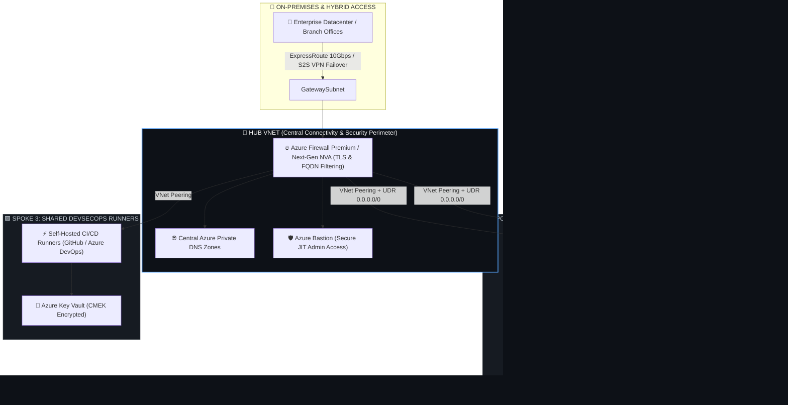

<p align="center">
  
</p>

<p align="center">
  <a href="https://github.com/sumduben-devops">
    
  </a>
</p>

<p align="center">
  <a href="https://linkedin.com/in/sumitduben"></a>
  <a href="mailto:sumduben@gmail.com"></a>
  <a href="https://github.com/sumduben-devops"></a>
  
</p>

---

### 🌟 Executive Overview: 11 Years IT | 5 Years Pure DevSecOps

> **Senior / Lead DevSecOps Engineer** backed by **11+ years of comprehensive IT systems engineering**, with the last **5+ years laser-focused on Enterprise DevSecOps, Cloud-Native Architectures, and Zero-Trust Automation**.

Combines deep infrastructure foundation (compute virtualization, storage topologies, network security, OS internals) with cutting-edge hands-on DevSecOps engineering: orchestrating **Monolithic-to-Microservices modernizations**, implementing **Enterprise Hub-and-Spoke landing zones**, hardening **multi-stage CI/CD pipelines** with shift-left security gates, and executing **100+ application cloud migrations** with zero downtime.

```
┌──────────────────────────────────────────────────────────────────────────────────────────────────┐
│                                    EXPERIENCE BLUEPRINT                                          │
├─────────────────────────────────────────────────┬────────────────────────────────────────────────┤
│ 💼 11+ Years Total Engineering Foundation       │ 🛡️ 5+ Years Dedicated DevSecOps & Cloud        │
├─────────────────────────────────────────────────┼────────────────────────────────────────────────┤
│ • Enterprise Infrastructure & System Operations │ • Shift-Left CI/CD Pipeline Engineering        │
│ • Monolithic 3-Tier Architectures & Databases   │ • Microservices on Kubernetes (AKS/EKS)        │
│ • Hybrid Networking, VPNs & Routing Protocols   │ • Terraform / Terragrunt IaC & Drift Control   │
│ • High Availability, BCDR & Disaster Recovery   │ • Zero-Trust Identity (Entra ID, PIM, CMEK)    │
│ • Production Delivery & Stakeholder Management  │ • FinOps Continuous Cloud Cost Optimization    │
└─────────────────────────────────────────────────┴────────────────────────────────────────────────┘
```

---

### 🏛️ Monolithic Architecture vs. Modern Microservices

A core strength of 11 years in IT is understanding **both worlds**: running, stabilizing, and decomposing complex legacy monoliths, and building resilient, distributed microservices from scratch.

<table>
  <tr>
    <th width="50%" align="center">🏛️ Legacy Monolithic Architecture</th>
    <th width="50%" align="center">⚡ Modern Cloud-Native Microservices</th>
  </tr>
  <tr>
    <td>
      <ul>
        <li><b>Topology:</b> Single codebase, unified relational DB, tightly coupled 3-tier compute (Web / App / DB).</li>
        <li><b>Deployment:</b> Monolithic release trains, scheduled weekend downtime maintenance windows.</li>
        <li><b>Scaling:</b> Vertical scaling (Scale-up) or coarse VM Scale Sets (VMSS).</li>
        <li><b>Security:</b> Perimeter-only defense (Firewalls, single ingress).</li>
        <li><b>My Role:</b> Decoupling bottlenecks, database segregation, implementing the <b>Strangler Fig Pattern</b>, and building blue/green cutover pipelines.</li>
      </ul>
    </td>
    <td>
      <ul>
        <li><b>Topology:</b> Decoupled containerized services running on <b>Kubernetes (AKS)</b> with API Gateways.</li>
        <li><b>Deployment:</b> Independent CI/CD micro-pipelines, Zero-downtime rolling & Canary deployments.</li>
        <li><b>Scaling:</b> Horizontal Pod Autoscaling (HPA) + Cluster Autoscaler based on CPU, memory, and custom metrics.</li>
        <li><b>Security:</b> Zero-Trust, Mutual TLS (mTLS), Pod Security Standards, container vulnerability scanning.</li>
        <li><b>My Role:</b> Building multi-tenant AKS clusters, GitOps pipelines, Helm charts, and shift-left scanning.</li>
      </ul>
    </td>
  </tr>
</table>

---

### 🌐 Enterprise Hub-and-Spoke Network Architecture

The architectural backbone for enterprise multi-subscription cloud deployments, segregating **Platform Shared Services**, **Microservices Workloads**, and **Modernized Monoliths**:



---

### 🛡️ End-to-End DevSecOps CI/CD Pipeline

A comprehensive, zero-trust automated pipeline ensuring every artifact and infrastructure change is scanned, validated, and approved before hitting production:

```mermaid
flowchart LR
    DEV["🧑‍💻 Engineer Workstation"] -->|git commit| PRE["🔍 Pre-Commit: TruffleHog / GitLeaks"]
    PRE -->|git push| PR["🔀 Pull Request (CODEOWNERS + 2 Approvals)"]

    subgraph CI["⚡ AUTOMATED DEVSECOPS CI PIPELINE"]
        PR --> LINT["1. Lint & Format (tflint / terraform fmt)"]
        LINT --> SAST["2. SAST (SonarQube) & SCA (Snyk)"]
        SAST --> CONTAINER["3. Container Scan (Trivy / ACR)"]
        CONTAINER --> IAC["4. IaC Security (Checkov & tfsec)"]
        IAC --> FINOPS["5. FinOps Gate (Infracost PR Diff)"]
        FINOPS --> PLAN["6. Terraform Plan Artifact"]
    end

    PLAN --> GATE{"🚦 CAB / Tech Lead Approval Gate"}
    GATE -->|Approved| CD["🚀 Automated Terraform Apply & Helm Deploy"]
    CD --> RUNTIME["👁️ Microsoft Defender for Cloud & Azure Policy Audit"]

    classDef stage fill:#0d1117,stroke:#58a6ff,stroke-width:2px,color:#fff;
    classDef node fill:#161b22,stroke:#30363d,stroke-width:1px,color:#c9d1d9;
    class CI stage;
```



---

### 🧱 4-Layer Defense-in-Depth Security Matrix

| Security Layer | Architecture Controls & Enforcements | Tooling & Implementation |
| :--- | :--- | :--- |
| **1. Identity Level** | • Zero permanent admin credentials.<br>• Just-In-Time (JIT) role elevation via PIM.<br>• Conditional Access + MFA for all tenants.<br>• Managed Identities for all compute workloads (No hardcoded secrets). | **Microsoft Entra ID (PIM)**, Azure AD Conditional Access, Azure Key Vault, OIDC Federations. |
| **2. Networking Level** | • Hub-and-Spoke isolation with default deny rules.<br>• Forced tunneling (`0.0.0.0/0`) via central firewall.<br>• Micro-segmentation with Network & Application Security Groups (NSGs/ASGs).<br>• Zero public endpoints on PaaS data services. | **Azure Firewall Premium**, Azure Private Endpoints, Azure Private DNS Zones, Application Gateway WAF v2. |
| **3. Governance Level** | • Built-in & Custom Policy initiatives assigned at Management Group scope.<br>• `Deny` rules for unencrypted storage and non-whitelisted SKUs.<br>• Time-bound formal policy exemption workflows with mandatory audits. | **Azure Policy**, Microsoft Cloud Security Benchmark (MCSB), CIS Azure Benchmark, Defender CSPM. |
| **4. Compute & Container Level** | • Immutable hardened golden images via Packer.<br>• Automatic kernel & OS vulnerability patching.<br>• In-line container image scanning in pipeline and registry.<br>• Encryption at rest with Customer-Managed Keys (CMEK). | **Trivy**, **Checkov**, **Defender for Servers & Containers**, Azure Disk Encryption (ADE). |

---

### 🛠️ Technical Arsenal & Ecosystem Badges

<table>
  <tr>
    <th align="center" width="22%">Category</th>
    <th align="center" width="78%">Technologies, Platforms & Tools</th>
  </tr>
  <tr>
    <td align="left"><b>☁️ Cloud & Platforms</b></td>
    <td>
      
      
      
      
      
    </td>
  </tr>
  <tr>
    <td align="left"><b>🛡️ DevSecOps & Security</b></td>
    <td>
      
      
      
      
      
      
      
      
      
    </td>
  </tr>
  <tr>
    <td align="left"><b>☸️ Microservices & IaC</b></td>
    <td>
      
      
      
      
      
      
      
    </td>
  </tr>
  <tr>
    <td align="left"><b>⚡ CI/CD & Automation</b></td>
    <td>
      
      
      
      
      
      
      
    </td>
  </tr>
  <tr>
    <td align="left"><b>💰 FinOps & SRE</b></td>
    <td>
      
      
      
      
      
    </td>
  </tr>
</table>

---

### 💼 High-Impact Enterprise Case Studies

<details open>
<summary><b>1. 🔄 Monolith-to-Microservices Modernization (Strangler Fig Pattern)</b></summary>
<br>

* **The Challenge:** A mission-critical legacy .NET/Java monolith hosted on virtual machines suffered from 4-hour deployment cycles, frequent single-point-of-failure outages, and tight database coupling.
* **The Solution:** 
  * Implemented an **Azure Application Gateway** with path-based routing in front of the monolith.
  * Systematically carved out bounded contexts (Authentication, Product Catalog, Notifications) into independent containerized microservices running on **Azure Kubernetes Service (AKS)**.
  * Provisioned Azure Service Bus for asynchronous event messaging to break synchronous database deadlocks.
* **Outcome:** Slashed deployment cycle times from **4 hours to 8 minutes**, achieved **zero-downtime canary releases**, and allowed individual squads to ship independently.
</details>

<details>
<summary><b>2. 🌐 Enterprise Hub-and-Spoke Landing Zone Deployment (Azure CAF)</b></summary>
<br>

* **The Challenge:** Organization required a standardized, secure multi-subscription cloud platform for 50+ business applications with strict isolation between Platform and Workloads.
* **The Solution:**
  * Developed modular, versioned **Terraform** landing zones based on the Microsoft Cloud Adoption Framework (CAF).
  * Established a central **Hub VNet** with Azure Firewall Premium, automated UDR route tables forcing all traffic inspection, and ExpressRoute hybrid connectivity.
  * Deployed centralized Azure Private DNS zones and Private Endpoints, eliminating all public PaaS IPs.
* **Outcome:** Provided 1-click self-service subscription provisioning for development squads while guaranteeing 100% compliance with corporate network security policies.
</details>

<details>
<summary><b>3. 🚢 100+ Enterprise Workloads Cloud Migration (Dev, UAT, Production)</b></summary>
<br>

* **The Challenge:** Datacenter lease expiry required migrating 100+ multi-tier workloads spanning Dev, UAT, and Production to Microsoft Azure within a tight 9-month timeframe.
* **The Solution:**
  * Executed comprehensive discovery via Azure Migrate, mapping server dependencies and non-overlapping IPAM CIDRs.
  * Executed 6-R strategy: Rehosting IaaS workloads via automated migration appliances and Replatforming web/DB tiers to managed PaaS.
  * Conducted cutover rehearsals, database replication delta syncs, and established a 24/7 war room for 3 weeks of hypercare.
* **Outcome:** Successfully migrated all 100+ workloads ahead of schedule with **zero unscheduled downtime** and **99.99% post-migration SLA reliability**.
</details>

<details>
<summary><b>4. 🛡️ Shift-Left DevSecOps Pipeline & Automated Drift Detection</b></summary>
<br>

* **The Challenge:** Security audits were conducted manually post-deployment, creating weeks of release delays, while manual console changes caused unmanaged infrastructure drift.
* **The Solution:**
  * Standardized enterprise CI/CD YAML templates in Azure DevOps and GitHub Actions.
  * Enforced shift-left automated quality gates: `TruffleHog` (secrets), `SonarQube` (SAST), `Snyk` (SCA), and `Checkov` / `tfsec` (IaC security).
  * Configured automated nightly drift detection pipelines (`terraform plan -detailed-exitcode`) paired with PagerDuty alerts.
* **Outcome:** Reduced critical production vulnerabilities by **92%**, reduced security sign-off time from **2 weeks to automated instant PR validation**, and eradicated console drift.
</details>

<details>
<summary><b>5. 💰 Enterprise FinOps & Cloud Waste Elimination</b></summary>
<br>

* **The Challenge:** Unmonitored cloud sprawl led to runaway monthly cloud bills across Dev, UAT, and Production subscriptions.
* **The Solution:**
  * Built automated scripts and Azure Policies to reclaim unattached managed disks, obsolete snapshots, and orphaned public IPs.
  * Automated scheduled start/stop runbooks for non-production compute during off-business hours.
  * Integrated **Infracost** into CI/CD PR checks to provide instant monthly cost impact visibility to developers before merging.
  * Analyzed workload usage patterns to purchase 1-year and 3-year Azure Reserved Instances (RIs) and Savings Plans.
* **Outcome:** Achieved a **32% net reduction in annual cloud spend** without impacting system performance or engineering velocity.
</details>

---

### 📊 Engineering Analytics & Activity

<p align="center">
  
  
</p>

<p align="center">
  
  
</p>

---

### 🤝 Connect & Collaborate

Whether you're modernizing a legacy monolith, architecting a resilient multi-tenant Kubernetes platform, establishing enterprise DevSecOps pipelines, or driving cloud cost optimization—let's connect.

<p align="center">
  <a href="https://linkedin.com/in/sumitduben">
    
  </a>
  &nbsp;&nbsp;
  <a href="mailto:sumduben@gmail.com">
    
  </a>
</p>

<p align="center">
  
</p>
